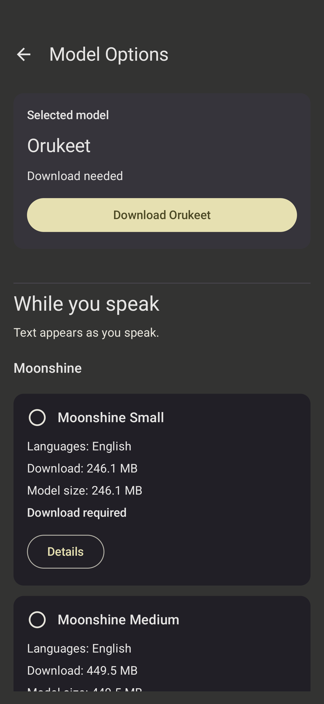
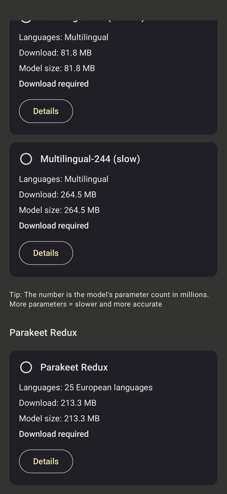
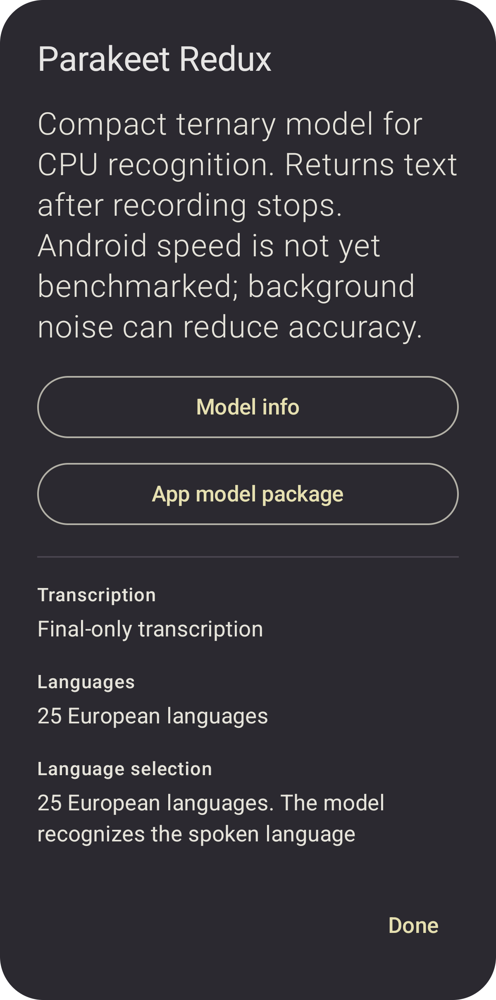

# Model guide

[Back to the README](../README.md)

Start with **Orukeet**, the default, then try **Advanced settings → Model comparison**.
We recommend comparing two or three typical passages on your own phone before
choosing a daily model. Speed, recognition quality and memory use depend on the
device, language and speech. See the [comparison instructions](model-comparison.md).

## Model Options screenshots

The current interface shows the selected model and expandable model families.
Open a family to see variants, language coverage, download and unpacked model
sizes. Details link to model information and the package used by the app.

Captured in the Android emulator from the beta 8 implementation promoted to
1.4.7. Model size means files on disk, not runtime RAM.

The following historical screenshots show the 1.4.6 layout before model families
became expandable:

Captured on a Samsung Galaxy S25 Ultra running Android 16 for 1.4.6 Share beta 7.

## Compare models

1.4.7 includes **ASR4ALL Small, Medium and Large** for live
English dictation. They add punctuation, capital letters and small corrections
with built-in PCEC, so S1-mini is skipped for these models. Downloads are about
38.6, 72.5 and 123.1 MB. All three use the low-latency `c16r4` streaming tier;
Plus models are omitted because their extra speaker features do not help this
dictation flow. See the [implementation and S25 Ultra test report](research/ticket-26-asr4all-feasibility-2026-10-09.md)
for pinned sources, timings and test limits.

| What you want | Try first | Next option |
| --- | --- | --- |
| Everyday dictation in a supported European language | Orukeet | Parakeet TDT V3 |
| Live English text with a lighter model | Moonshine Small | Moonshine Medium, then Nemotron English |
| Live English text with built-in formatting | ASR4ALL Small | ASR4ALL Medium or Large if your phone handles them well |
| A very small multilingual download | Whistle, experimental | Check first-run speed on your phone; it reloads each recording |
| Live multilingual text | Nemotron 3.5 Multilingual | Orukeet if final-only text is acceptable |
| Arabic dictation | Cohere Transcribe with Arabic selected | Whisper multilingual |
| A smaller multilingual download to experiment with | Parakeet Redux | Orukeet; Redux still needs Android device validation |
| Optional English legacy fallback | Whisper English | A live English model or Orukeet; Whisper is not required for normal English dictation |
| Languages beyond the other models' coverage | Whisper multilingual | Check the language and model results before relying on it |

We keep several models because language coverage, live text, download size and recognition results differ. Alternatives let you find one that suits your speech and phone; Whisper preserves the original FUTO path. S1-mini is optional English text cleanup after recognition, a separate choice from the speech model. This guide is a starting point, not a phone benchmark or an accuracy ranking.

These are the options exposed by this app, not every capability of the upstream models. The use cases describe intended trade-offs, not a measured ranking across Android devices.

| Model | Languages in the app | Text appears | Purpose and trade-off | Model source |
| --- | --- | --- | --- | --- |
| **Orukeet · default** | 25 European languages | After Stop | Starting point for everyday dictation. A Parakeet-derived model with multilingual and accent-focused adaptation; no live partials. | [Oruk AI](https://huggingface.co/oruk/orukeet) |
| **ASR4ALL Small** | English | Live | Smallest ASR4ALL option, with built-in PCEC punctuation, capitalization and small corrections. S1-mini is skipped. | [FUTO Small](https://huggingface.co/futo-org/asr4all-s) |
| **ASR4ALL Medium** | English | Live | Middle ASR4ALL size with the same PCEC stage; uses more storage and processing than Small. | [FUTO Medium](https://huggingface.co/futo-org/asr4all-m) |
| **ASR4ALL Large** | English | Live | Largest ASR4ALL option with PCEC; compare accuracy gains against the extra resource use. | [FUTO Large](https://huggingface.co/futo-org/asr4all-l) |
| **Whistle, experimental** | English, German, French, Spanish, Italian, Dutch, Polish; auto-detect | After Stop | Very small download; separate CPU worker loads for every recording. Live text and manual language selection are not exposed by this app. | [Cactus Compute](https://huggingface.co/Cactus-Compute/whistle) |
| **Phonon 2, experimental** | English | After Stop | Punctuation and capitalization; separate CPU runtime. Android performance varies and has no controlled ranking here. | [Fermion Research](https://www.fermionresearch.com/models/phonon-2/) · [app package/runtime](https://huggingface.co/eschmidbauer/phonon-2-c) |
| **Parakeet Redux** | 25 European languages | After Stop | Compact packed ternary CPU model, about 213 MB. Android speed is unmeasured; publisher results show a noise-accuracy trade-off. | [Moondream](https://huggingface.co/moondream/parakeet-redux) · [packed GGUF](https://huggingface.co/mudler/parakeet-cpp-gguf) |
| **Moonshine Small** | English | Live | Lighter English streaming option when resource use matters. | [Moonshine AI](https://github.com/moonshine-ai/moonshine) |
| **Moonshine Medium** | English | Live | Larger English streaming option intended to favor accuracy, with greater resource use than Small. | [Moonshine AI](https://github.com/moonshine-ai/moonshine) |
| **Parakeet TDT 0.6B V3** | 25 European languages | After Stop | NVIDIA's multilingual alternative to Orukeet, useful for comparing results on your own speech. | [NVIDIA](https://huggingface.co/nvidia/parakeet-tdt-0.6b-v3) · [INT8 export](https://huggingface.co/twmht/sherpa-onnx-nemo-parakeet-tdt-0.6b-v3-int8) |
| **Parakeet Unified EN 0.6B** | English | Buffered live | Recomputes recent context for live updates. More work per update than a recognizer that reuses cached streaming state. | [Sherpa-ONNX export](https://huggingface.co/csukuangfj2/sherpa-onnx-nemo-parakeet-unified-en-0.6b-int8-streaming-560ms) |
| **Nemotron English** | English | Live | Choose Low latency, Balanced, or Accuracy profiles to trade update frequency against recognition context. | [NVIDIA](https://huggingface.co/nvidia/nemotron-speech-streaming-en-0.6b) · [Sherpa-ONNX packages](https://github.com/k2-fsa/sherpa-onnx/releases/tag/asr-models) |
| **Nemotron 3.5 Multilingual** | 28 languages, with Auto-detect | Live | Multilingual streaming with explicit language selection or automatic detection. | [Sherpa-ONNX export](https://huggingface.co/csukuangfj2/sherpa-onnx-nemotron-3.5-asr-streaming-0.6b-560ms-int8-2026-06-11) |
| **Cohere Transcribe** | 14 languages, including Arabic and English | After Stop | Another multilingual option, particularly for Arabic. Explicit language selection; a large download and substantial memory use. | [Cohere Labs](https://huggingface.co/CohereLabs/cohere-transcribe-03-2026) · [INT8 export](https://huggingface.co/csukuangfj2/sherpa-onnx-cohere-transcribe-14-lang-int8-2026-04-01) |
| **Whisper · legacy** | English and multilingual options | Final after Stop; legacy decode progress may show partials | Preserves FUTO's original Whisper/GGML path as a fallback and comparison option. | [FUTO source and model integration](https://github.com/futo-org/voice-input) |
| **S1-mini by Superwhisper** | English text | After recognition | Optional transcript cleanup, not speech recognition. Adds processing time to improve the presentation of dictated text. | [Superwhisper GGUF](https://huggingface.co/superwhisper/s1-mini-GGUF) |

Nemotron English's 80, 160, and 560 ms profile values describe audio chunks, not guaranteed end-to-end latency. Phone hardware, recording length, language, and model all affect results. Publisher benchmarks are not measurements of this Android app.

See the [Redux, Ultra, and Orukeet comparison](parakeet-redux-comparison.md) for published accuracy, CPU measurements, storage, and their limits. Redux uses a pinned MIT parakeet.cpp runtime and converted CC BY 4.0 weights by Moondream, derived from NVIDIA Parakeet. Ultra is compared there but is not an app option.

Cohere download and recognition, history improvements, and the popup were manually tried on a Samsung Galaxy S25 Ultra. No comparative speed, memory, or accuracy benchmark was collected. Cohere has no automatic language detection, and mixed-language dictation can be inaccurate.

## Files and RAM

Sizes below are decimal MB from the app's pinned catalog, rounded to one decimal.
An archive needs temporary space alongside its extracted files. RAM is additional;
unknown means no comparable measurement is available, not zero usage.

| Model or variant | Download MB | Installed model files MB | Available RAM evidence |
| --- | ---: | ---: | --- |
| ASR4ALL Small | 38.6 | 38.6 | 273 MiB sampled app/test PSS on one S25 Ultra fixture |
| ASR4ALL Medium | 72.5 | 72.5 | 324 MiB on the same fixture |
| ASR4ALL Large | 123.1 | 123.1 | 422 MiB on the same fixture |
| Whistle | 16.9 | 16.9 | Unknown; comparison excludes its separate worker |
| Phonon 2 | 186.6 | 255.4 | Unknown; measure sampled app RAM on your device |
| Orukeet | 486.8 | 671.6 | Unknown across devices; use Model comparison |
| Parakeet Redux | 213.3 | 213.3 | Unknown across devices |
| Moonshine Small | 246.1 | 246.1 | Unknown across devices |
| Moonshine Medium | 449.5 | 449.5 | Unknown across devices |
| Parakeet TDT V3 | 670.5 | 670.5 | Unknown across devices |
| Parakeet Unified EN | 663.0 | 663.0 | Unknown across devices |
| Nemotron English, each 80/160/560 ms profile | 463.9 | 661.9 | Unknown across devices; profiles have separate packages |
| Nemotron 3.5 Multilingual | 682.2 | 682.2 | Unknown across devices |
| Whisper English-39 / -74 / -244 | Included / 81.8 / 264.5 | 43.6 / 81.8 / 264.5 | Unknown across devices |
| Whisper multilingual tiny / base / small | 43.5 / 81.8 / 264.5 | 43.5 / 81.8 / 264.5 | Unknown across devices |
| S1-mini, optional text cleanup | 484.2 | 484.2 | Separate from recognition; unknown across devices |

The ASR4ALL figures include UI and instrumentation overhead. They came from an
11-second English fixture on a Samsung Galaxy S25 Ultra, Android 16, with the
c16r4 INT8 package. They are sampled PSS, not model-only allocations or guarantees.
See the [full device report](research/ticket-26-asr4all-feasibility-2026-10-09.md).

## Performance evidence and its limits

| Evidence | What it measures | How to use it |
| --- | --- | --- |
| This app's [ASR4ALL device report](research/ticket-26-asr4all-feasibility-2026-10-09.md) | S25 Ultra, 11-second fixture, paced input and whole-file decoding; whole-file times 523/920/1,544 ms for Small/Medium/Large | Checks one clean fixture and the integration, not a general accuracy ranking |
| [FUTO ASR4ALL Small model card](https://huggingface.co/futo-org/asr4all-s#benchmark-results) | Publisher single-thread acoustic throughput, median of three 120-second clips: c16r4 INT8 14.6× realtime on Pixel 4 and 32.4× on Pixel 10 | PCEC is extra work; published WER uses a different c256r64 profile from this app |
| [Fermion Phonon 2 evaluation](https://www.fermionresearch.com/models/phonon-2/#evaluation) | Publisher 5.21% average WER across seven Open ASR Leaderboard English sets; speed on Apple hardware, Zen 5 CPU and H100 | Different package and runtime from this app's Android CPU integration |
| [Cactus Whistle benchmarks](https://huggingface.co/Cactus-Compute/whistle#benchmarks) | Publisher WER across full test splits; speed uses ten seconds of audio on Apple M4 Pro | Does not establish Android speed, warm-model timing or RAM |
| [Redux/Orukeet/Parakeet source comparison](parakeet-redux-comparison.md) and model cards above | Publisher datasets, desktop/runtime conditions and known packaging differences | Follow the source conditions; different datasets and runtimes cannot rank Android models fairly |

There is no controlled cross-model phone leaderboard for this release. For the
other variants, comparable Android speed and accuracy remain unknown. Use the
same audio, correct references and the same device to compare them yourself.

## Practical starting choices

- On a slower phone or with limited storage, try ASR4ALL Small for live English
  or Whistle for its supported languages if final-only text is acceptable.
  These are starting points based on package size and deployment design; compare
  speed and accuracy on the actual device before relying on either.
- For English with built-in formatting, compare ASR4ALL sizes. For live text
  without that PCEC stage, compare Moonshine and Nemotron English. For final-only
  English, include Orukeet, Phonon 2 and the Parakeet variants.
- For Spanish and supported European languages, start with Orukeet and compare
  Parakeet TDT V3 or Redux. Whistle supports Spanish plus six other languages.
  Nemotron Multilingual provides live text and optional automatic detection.
- For Arabic, compare Cohere with Arabic selected, Nemotron Multilingual and
  multilingual Whisper. For languages outside a model's supported list, choose
  one that actually covers them; automatic detection does not add languages.
- A stronger phone can make larger ASR4ALL, Moonshine, Nemotron or Cohere options
  practical, but extra size does not guarantee a better result for your speech.
  Compare both first-run wait and already-loaded time. Keep Whisper English as
  an optional legacy fallback; use multilingual Whisper for its broader coverage.

Try ordinary microphone dictation after the fixed-audio comparison. Live update
cadence, keyboard behavior, sustained heat and battery use require that check.

## Model downloads

### Whistle experimental option

Whistle adds a 16.9 MB final-only model for English, German, French, Spanish,
Italian, Dutch and Polish, with automatic language detection. Download it from
Model Options, then select it. Orukeet remains the default.

The app uses revision-pinned, SHA-256-checked [Cactus Whistle weights](https://huggingface.co/Cactus-Compute/whistle)
and an unmodified [Needle ARM64 runtime](https://huggingface.co/Cactus-Compute/needle3),
both under Apache 2.0. It runs offline in a separate process with two CPU threads;
the process exits after each recording, releasing model memory. Temporary audio
and results stay in app-private cache and are deleted on completion, failure or
cancellation. An interrupted app process can leave scratch files, cleared on the
next nonempty Whistle run or by Android's cache cleanup. Audio history remains a
separate setting. Runtime logs are discarded.

Text appears after Stop; live transcription and manual language selection are not
exposed in this app. English cleanup only runs when English is established by
recognition. The Light rating is advisory: Android speed, RAM, accuracy and
performance on older phones have not been measured. Each recording includes a
cold model load; the publisher's desktop timings do not measure this app.

### Phonon 2 experimental option

Phonon 2 produces English text after Stop, including punctuation and capitalization.
It uses a separate pinned [phonon-2-c runtime](https://github.com/eschmidbauer/phonon-2-c)
and [repackaged five-value weights](https://huggingface.co/eschmidbauer/phonon-2-c).
The model card uses the same download, selection, deletion and Details controls as
the other models. Orukeet remains the default.

The download is 186.6 MB and the installed files total 255.4 MB. Allow at least
442.1 MB free for installation; runtime RAM is additional. The publisher's 164 MB
figure describes its original archive, not this app's package.

The runtime uses four CPU threads, selects ARM dot-product instructions only on
supported hardware, and otherwise uses the baseline ARM64 implementation.
Phonon is experimental: Android speed, memory use and accuracy have not been
verified. The publisher's benchmarks do not measure this app. Long recordings
use the runtime's pause-based windows, and cancellation waits for an in-flight
native decode to finish before releasing its model. Compare short recordings
against Redux and Orukeet before relying on it.

Models download separately into app-private storage. The normal APK does not bundle weights. Network access is needed for the initial download; recognition then works offline. S1-mini is a separate optional download.

- **Orukeet:** about 487 MB to download and 672 MB installed. Allow about 1.16 GB free during installation for the archive and extracted files. Interrupted downloads can resume when the server supports byte ranges.
- **Parakeet Redux:** about 213 MB to download and install, using a revision-pinned packed GGUF with SHA-256 verification. ARM dot-product support enables its NEON kernel; older ARM64 CPUs use a slower scalar fallback.
- **Cohere:** about 2.89 GB of model files, plus working memory during recognition. Longer recordings use chunks of up to 35 seconds; words near boundaries may need checking.
- **S1-mini:** about 484.2 MB for the pinned Q4_K_M model.
- **Moonshine:** quantized assets come directly from Moonshine AI's [Small](https://download.moonshine.ai/model/small-streaming-en/quantized/streaming_config.json) and [Medium](https://download.moonshine.ai/model/medium-streaming-en/quantized/streaming_config.json) download service.

The [model catalog](../app/src/main/java/org/futo/voiceinput/recognition/RecognitionModelCatalog.kt) records the app's selected packages and revisions. Linked model pages may describe newer upstream versions than the app downloads.
